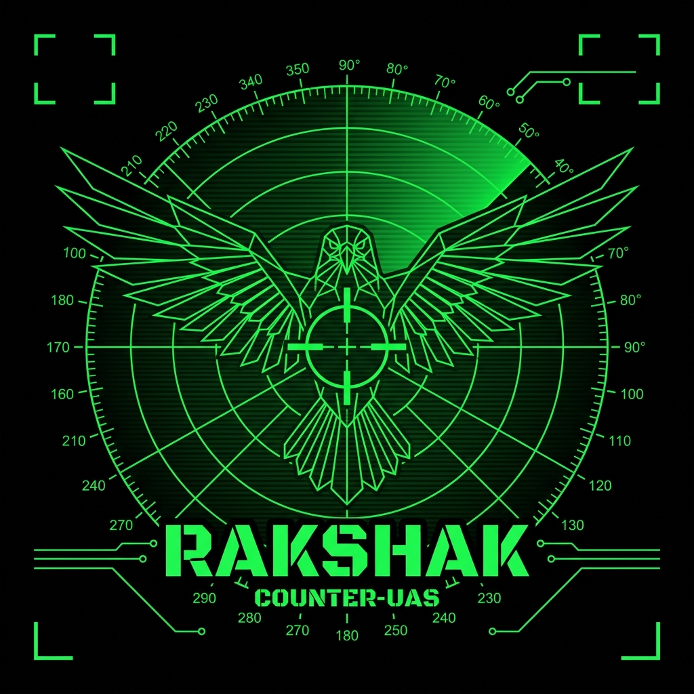

<div align="center">



# R.A.K.S.H.A.K.
### Real-time Autonomous Kinetic Simulation for Hostile Aerial Kill-chains

**PS 26247 · Ministry of Defence · Defence Services Staff College · SIH 2026**

[](https://github.com/mayankcodes-dev/R.A.K.S.H.A.K)
[](https://github.com/mayankcodes-dev/R.A.K.S.H.A.K)
[](https://www.gov.uk/guidance/sapient-autonomous-sensor-system)
[](https://github.com/mayankcodes-dev/R.A.K.S.H.A.K)

</div>

---

## The Problem

> **India faces 500+ rogue drone incidents yearly** across borders and critical infrastructure. Training operators to counter these threats through live-fire costs **₹50L–1Cr per drill** — restricted by airspace, weather, and safety regulations.

| | Metric |
|---|---|
| Cost of one live-fire C-UAS drill | ₹50 Lakh – ₹1 Crore |
| Live sessions per officer in entire career | **3–5** |
| Simulation runs possible with RAKSHAK | **1,000+** |
| Cost per simulation run | **₹0** |

### Three Compounding Failures

**01 — COST ASYMMETRY**
A ₹50,000 commercial drone can neutralize a ₹15 Crore armored vehicle. Yet training one operator to counter it costs ₹50 lakh — with weapons, targets, airspace clearance, and safety protocols.

**02 — TRAINING BOTTLENECK**
DSSC trains ~2,800 officers/year. Live-fire counter-drone drills need restricted ranges, WPC spectrum clearance, target drones, and ideal weather. Result: 3–5 live sessions per career — not enough to build muscle memory.

**03 — UNJAMMABLE THREATS (2024–2026)**
Fiber-optic FPV drones trail a physical glass fiber cable — **zero RF emission, immune to all electronic warfare**. Current training ignores this paradigm shift entirely. Operators trained only on RF-jamming will fail against this threat.

---

## The Solution

**R.A.K.S.H.A.K.** is a browser-based, WebGL-powered Counter-UAS training simulator that runs on **standard military laptops — no specialized hardware**. Operators practice the full kill-chain:

```
Detect → Classify → Track → Engage → Assess
```

Against AI-driven adversary drones — fiber-optic FPVs, autonomous swarms, loitering munitions — in procedurally generated environments with real sensor emulation.

| | Capability | Detail |
|---|---|---|
| **AI Adversary** | Not scripted | DDQN-trained hostile drones that evade, terrain-mask, and exploit sensor gaps — never the same scenario twice |
| **Sensor Emulation** | Not game graphics | Micro-Doppler radar spectrograms, RF waterfall displays, EO/IR feeds — actual sensor physics |
| **Cost** | ₹0 per run | Browser-based WebGL. No VR headset. No GPU. No installation. Runs at every unit level |

---

## Comparison

| Feature | Live-Fire Drill | VR/Proprietary Sim | **R.A.K.S.H.A.K.** |
|---|:---:|:---:|:---:|
| Cost per session | ₹50L+ | ₹5L (hardware) | **₹0** |
| Runs on standard laptop | ✗ | ✗ | **✓** |
| Fiber-optic drone scenario | ✗ | ✗ | **✓** |
| Micro-Doppler spectrogram | ✗ | ✗ | **✓** |
| AI-adaptive adversary (DDQN) | ✗ | Limited | **✓** |
| Swarm scenarios (50+ drones) | ✗ Unsafe | Needs GPU | **✓** |
| SAPIENT protocol compliance | N/A | ✗ | **✓** |
| Works offline (field deployment) | N/A | ✗ | **✓** |
| After-Action Review analytics | Manual debrief | Basic stats | **✓ Full decision-tree** |
| Airspace/WPC clearance needed | Required | ✗ | **✗** |

### vs. Existing Indian/Foreign Solutions

| Feature | Zen 3ADS | DRDO Lab | RAFAEL/Thales | **R.A.K.S.H.A.K.** |
|---|:---:|:---:|:---:|:---:|
| Runs on standard laptop | ✗ | ✗ | ✗ | **✓** |
| Browser-based (no install) | ✗ | ✗ | ✗ | **✓** |
| Fiber-optic FPV scenarios | ✗ | ✗ | ✗ | **✓** |
| Micro-Doppler radar emulation | ✗ | Limited | Limited | **✓** |
| AI-adaptive adversary (DDQN) | ✗ | ✗ | Limited | **✓** |
| SAPIENT protocol | ✗ | ✗ | Limited | **✓** |
| NLG After-Action Review | ✗ | ✗ | ✗ | **✓** |
| Cost per session | ₹5L+ | ₹50L+ | ₹10L+ license | **₹0** |
| Atmanirbhar (Made in India) | ✓ | ✓ | ✗ | **✓** |
| Offline deployable | ✗ | N/A | ✗ | **✓** |

---

## Architecture

```
┌─────────────────────────────────────────────────────────────────────┐
│                    R.A.K.S.H.A.K. SYSTEM ARCHITECTURE               │
├─────────────────────────────────────────────────────────────────────┤
│                                                                     │
│  ┌──────────────────────────────────────┐                           │
│  │       SCENARIO GENERATION ENGINE     │                           │
│  │  Procedural terrain · Threat library │                           │
│  │  FPV · Swarm · Loiter · Weather/Time │                           │
│  │              ▼                       │                           │
│  │     DDQN Adversary Agent (RL)        │                           │
│  │     • Evasion AI  • Terrain-mask     │                           │
│  │     • Swarm coordination             │                           │
│  └──────────────────┬───────────────────┘                           │
│                     ▼                                               │
│  ┌──────────────────────────────────────────────────────────────┐   │
│  │           BACKEND — FastAPI + PostgreSQL + Redis              │   │
│  │  Physics Engine        SAPIENT v7 Protocol   ROE Validator    │   │
│  │  (Radar equation,      (Protobuf/JSON,        (Collateral     │   │
│  │   RCS calc,             sensor messaging,      damage,        │   │
│  │   micro-Doppler)        NATO standard)         civilian IFF)  │   │
│  └──────────────────────────┬───────────────────────────────────┘   │
│                             ▼                                       │
│  ┌──────────────────────────────────────────────────────────────┐   │
│  │           FRONTEND — React + Three.js + WebGL                 │   │
│  │  Tactical Map        3D Simulation         Sensor Dashboard   │   │
│  │  (Leaflet dark       (Three.js WebGL,       • Radar display   │   │
│  │   tiles)              GLSL shaders)         • RF waterfall    │   │
│  │                                             • EO/IR feed      │   │
│  │                                             • Acoustic DOA    │   │
│  └──────────────────────────┬───────────────────────────────────┘   │
│                             ▼                                       │
│  ┌──────────────────────────────────────────────────────────────┐   │
│  │           AFTER-ACTION REVIEW (AAR) DASHBOARD                │   │
│  │  Timeline            Decision-Tree         NLG Feedback       │   │
│  │  (Chart.js)          Score Engine          "You wasted 14s    │   │
│  │  • Actions           • Detection           on RF jammer       │   │
│  │  • Delays            • Classification      against FO-FPV"    │   │
│  │  • Errors            • ROE compliance                         │   │
│  └──────────────────────────────────────────────────────────────┘   │
│                             │                                       │
│              Adaptive curriculum → biases future scenarios          │
└─────────────────────────────────────────────────────────────────────┘
```

### Tech Stack

| Layer | Technology |
|---|---|
| **3D Render** | Three.js + WebGL + GLSL shaders |
| **Frontend** | Next.js 16 + React + Tailwind CSS v4 + Leaflet |
| **Backend** | Python FastAPI + WebSocket |
| **Database** | PostgreSQL + Redis (session state) |
| **AI** | DDQN (PyTorch) adversary · LLM briefing generation |
| **Protocol** | SAPIENT v7 (Protobuf/JSON) |
| **Charts** | Chart.js (AAR dashboard) |
| **Deployment** | Docker + offline-first PWA |

---

## Scenarios

### `SCENARIO-001` — Silent Intruder `[SECRET]`
Fiber-optic FPV drone. Zero RF signature. Acoustic-only detection window. Tests: target acquisition under RF-null conditions, escalation authority, ROE compliance. Forces hard-kill decision — no EW option exists.

### `SCENARIO-002` — Swarm Storm `[SECRET]`
12–50 drone autonomous swarm with distributed tasking and dynamic re-routing. Tests: priority triage under saturation, simultaneous multi-vector engagement, kill-chain bandwidth limits.

### `SCENARIO-003` — Urban Ambush `[SECRET]`
Civilian airspace overlap in contested urban corridor. Hard ROE with changing authorization windows. Tests: IFF (Identification Friend or Foe), proportional response, escalation authority chains.

---

## True Innovation

| # | Innovation | Why It's Unique |
|---|---|---|
| **01** | **Fiber-optic FPV scenario** | Only simulator globally modeling unjammable drones that defeat ALL electronic warfare. Forces hard-kill decision training. |
| **02** | **Micro-Doppler spectrogram** | Trains radar interpretation — not just visual ID. Mathematical fidelity using STFT + radar equation. |
| **03** | **DDQN adversary AI** | Hostile drones learn to evade. Each session is unique — unlike scripted paths in all existing simulators. |
| **04** | **SAPIENT v7 compliance** | Internal messaging uses NATO SAPIENT standard → architecture plugs directly into DRDO/BEL hardware without code changes. |
| **05** | **NLG After-Action Review** | AI generates natural-language tactical error explanations — *"You wasted 14s on RF jammer against a fiber-optic drone."* |

---

## Feasibility

**Technical** — WebGL runs on Chrome 90+, Firefox 88+. Three.js achieves 60fps on Intel Iris Xe (standard military laptop). SAPIENT protocol ensures DRDO D4 hardware interoperability. Offline-first PWA — zero connectivity required.

**Operational** — Deployable by junior NCOs with zero specialized instructor. AI generates all feedback. Works on every laptop at every unit level.

**Cost**

| Item | Cost |
|---|---|
| Per training session | **₹0** |
| Hardware requirement | **None beyond existing laptops** |
| Cloud hosting | Free tier (Vercel + Railway) |
| vs Live-fire C-UAS drill | ₹50 Lakh – ₹1 Crore per session |

---

## Impact

| Stakeholder | Impact |
|---|---|
| **DSSC / Training Command** | 100x more training repetitions at 0.01% of cost. Standardized assessment via AAR data. |
| **Field Commanders** | Battle-ready operators who've trained against fiber-optic drones and swarms — not textbook awareness. |
| **DRDO / BEL** | SAPIENT-compliant → integrates with D4 system C2 interface for hybrid live+sim training. |
| **Indian Army / IAF** | Unit-level deployment on standard laptops. Every brigade trains without range allocation. |
| **Defence Budget** | Saves ₹50L–1Cr per drill. Simulation absorbs 80–90% of basic/intermediate training repetitions. |

---

## Research Foundation

| # | Source | What It Proves |
|---|---|---|
| 1 | [PMC — Micro-Doppler UAV Detection](https://pmc.ncbi.nlm.nih.gov/articles/PMC7219666/) | LSTM classification of drones vs birds via micro-Doppler |
| 2 | [IEEE — UAV Swarm Micro-Doppler](https://ieeexplore.ieee.org/document/11114859) | Swarm type ID using micro-Doppler spectrograms |
| 3 | [arXiv — AI Military Training Scenarios](https://arxiv.org/abs/2511.07690) | LLM-generated training scenario research |
| 4 | [NATO SAPIENT Adoption](https://www.unmannedairspace.info/counter-uas-systems-and-policies/nato-to-adopt-uks-sapient-protocol-as-c-uas-standard/) | NATO adopts UK SAPIENT as C-UAS interoperability standard |
| 5 | [GOV.UK SAPIENT ICD v7](https://www.gov.uk/guidance/sapient-autonomous-sensor-system) | Full interface control document for sensor messaging |
| 6 | [JPost — Fiber-Optic Drones](https://www.jpost.com/defense-and-tech/article-900672) | Battlefield evidence of unjammable FO-FPV drones |
| 7 | [ResearchGate — RL Counter-UAS](https://www.researchgate.net/publication/369056999) | Reinforcement Learning for C-UAS engagement |
| 8 | [CENJOWS — Indian C-UAS Doctrine](https://cenjows.in/wp-content/uploads/2025/12/Brig_Anshuman_Narang_primer_Aug25.pdf) | India-specific counter-drone architecture and doctrine |
| 9 | [BEL — Anti-Drone System D4](https://bel-india.in/product/anti-drone-system/) | DRDO D4 productionized by BEL |
| 10 | [Inside Unmanned — C-UAS Costs](https://insideunmannedsystems.com/counter-uas-the-price-of-the-shot/) | Cost-per-shot analysis for C-UAS engagements |

### Standards Compliance
- **SAPIENT v7 / BSI Flex 335 v2.0** — NATO sensor interoperability protocol
- **DRDO** — Integrated Air Defence framework alignment
- **Atmanirbhar Bharat** — 100% indigenous design, open-source stack, zero foreign dependency
- **DSSC Kill-chain Doctrine** — Detect → Classify → Track → Engage → Assess

---

<div align="center">

**Built in India. For India.**

*R.A.K.S.H.A.K. is a dual-use defense technology platform. All training scenarios are simulation environments.*
*Operational capabilities subject to applicable defence procurement regulations.*

</div>
